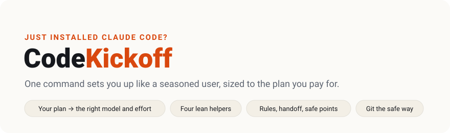

<p align="center">
  <picture>
    <source media="(prefers-color-scheme: dark)" srcset="assets/hero-dark.svg">
    
  </picture>
</p>

<p align="center">
  <a href="https://github.com/makavli/codekickoff/actions/workflows/test.yml"></a>
  <a href="https://github.com/makavli/codekickoff/releases/latest"></a>
  <a href="LICENSE"></a>
  
  
  
</p>

**Just installed Claude Code, or just paid for a plan?** CodeKickoff asks which plan you have and what you work on, then sets you up the way experienced users work: the right model and effort for your plan, small helpers that do the searching for less, rules that keep sessions short, and a git workflow that never costs you a surprise. Every change waits for your yes, and one command undoes it.

## Use

```text
claude plugin marketplace add makavli/codekickoff
claude plugin install codekickoff@codekickoff
```

Then, inside Claude Code:

```text
/codekickoff
```

Answer up to four questions. About one minute. Open a new session and type `/codekickoff check` to see it all in place.

<p align="center">
  <picture>
    <source media="(prefers-color-scheme: dark)" srcset="assets/demo-dark.svg">
    
  </picture>
</p>

| Command | What it does |
|---|---|
| `/codekickoff` | The guided setup. |
| `/codekickoff plan` | You changed plan: resize everything to it. |
| `/codekickoff check` | Shows what is set, missing or changed. |
| `/codekickoff undo` | Reverses any part, from the backups it made. |

To pin a version: `claude plugin marketplace add makavli/codekickoff#v0.1.0`. To update: `claude plugin marketplace update codekickoff`.

## What you get

**The right model and effort for your plan.** Pro, Max, Ultra, Team, Enterprise or pay-per-use API: each gets the setting that fits its allowance ([the table](skills/codekickoff/PLANS.md)). You learn the one command that raises effort for a hard moment, instead of spending it on every easy turn.

**Four lean helpers.** `scout` searches your files and `web-scout` searches the web, both on the small model; `worker` makes mechanical edits and `reviewer` reviews a finished change, both on the mid-size one. Each one reports back in a few lines, so your session stays short. No helper can read your files *and* the web. ([HELPERS.md](skills/codekickoff/HELPERS.md))

**Working rules.** Short habits Claude follows in every session: wait for a build once instead of checking it again and again, read only the part of the output that matters, send independent steps together, keep a `HANDOFF.md` with the state now, and stop at safe points to offer a fresh session when the conversation grows long. ([RULES.md](skills/codekickoff/RULES.md))

**Git the safe way, if you want it.** Every change on a branch and a pull request, Claude runs the check on your machine before each push, and a local guard stops a push to `main` by mistake. On a public repository it offers free CI; on a private one it tells you what CI minutes cost first, and the default costs nothing. ([GIT.md](skills/codekickoff/GIT.md))

## Promises

- **Your yes first.** It shows the whole setup before any edit, backs up each settings file, and changes only the keys it names.
- **Collects nothing.** No script, no hooks, no network. It is text that Claude reads.
- **Undo.** `/codekickoff undo` puts back the model and effort you had before, and removes its helpers, rules blocks and git guard, leaving anything you changed yourself.
- **Plays well with [Fewturns](https://github.com/makavli/fewturns).** The working rules are Fewturns' block under Fewturns' own markers. Install Fewturns later to trim what every request carries; you will never get the rules twice.

## Limits

- Plans, prices and limits change. The table was checked in November 2026 against Claude Code 2.1.322 and Anthropic's pages; when your screen says otherwise, believe your screen, and [tell us](https://github.com/makavli/codekickoff/issues).
- The Free plan does not include Claude Code, so there is nothing to set up there.
- An Enterprise admin can turn models off; ask yours what is on.

## Not affiliated

CodeKickoff is a community project. It is not made, endorsed or supported by Anthropic. Claude and Claude Code are Anthropic's trademarks, named here only to say what this works with.

## License

[MIT](LICENSE). Free for everyone, forever.
